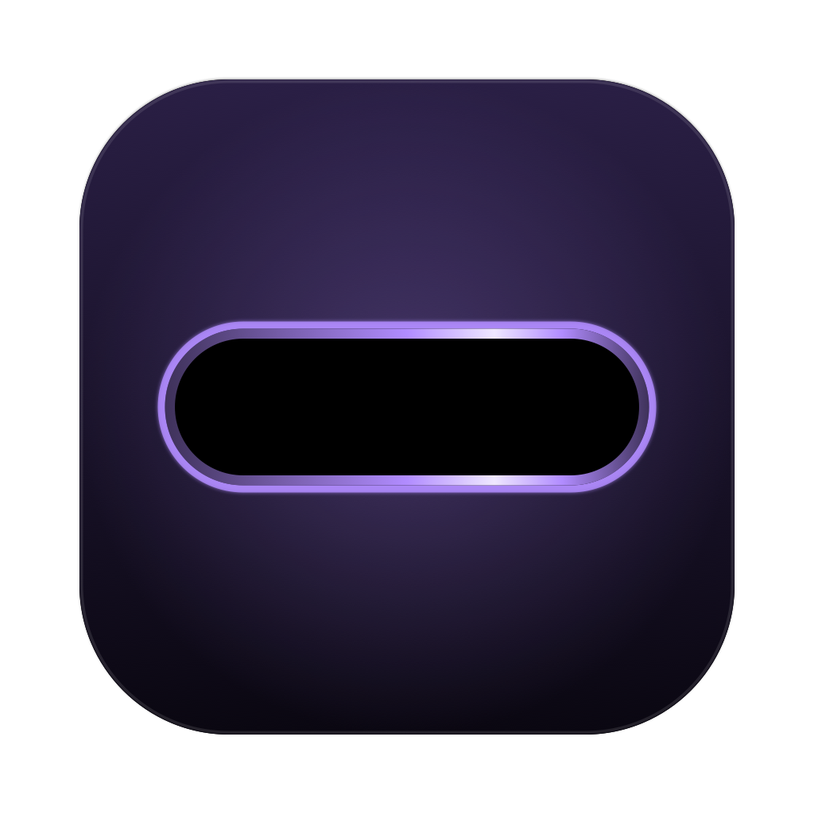
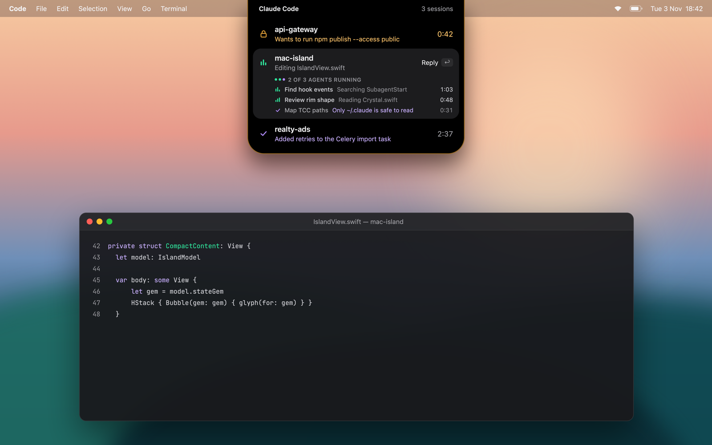
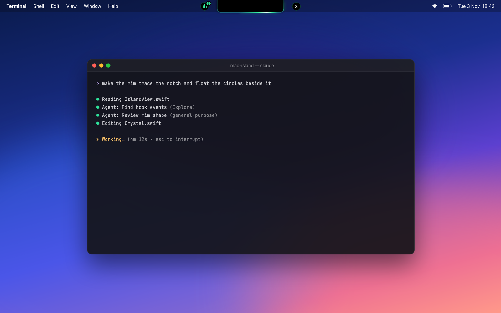
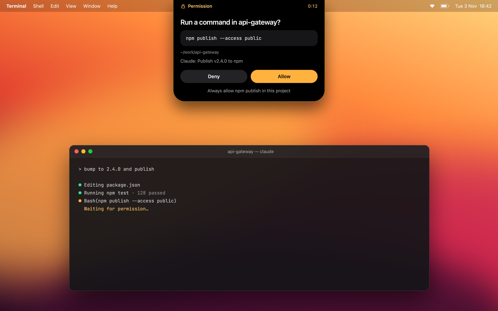
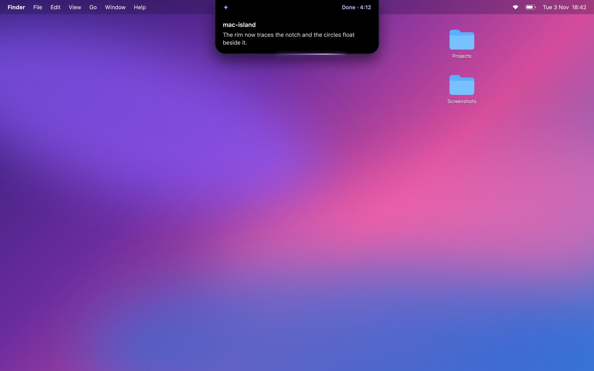

<p align="center">
  
</p>

<h1 align="center">Mac Island</h1>

<p align="center">
  A Dynamic Island for the MacBook notch that shows what your Claude Code sessions are doing.<br>
  Hover the notch to see every session, answer permission prompts and reply to Claude without leaving what you're doing.
</p>

<p align="center">
  <a href="https://github.com/fufic123/mac-island/releases/latest/download/MacIsland.zip">
    
  </a>
</p>

---

<p align="center">
  
</p>

## What it shows

The notch lights up with the state of your sessions, so a glance tells you whether you're needed:

| Light | Meaning |
|---|---|
| Amber | A session needs you: a permission prompt or a question |
| Emerald | Claude is working (the badge counts running subagents) |
| Amethyst | A session just finished; stays on for 5 minutes |
| Off | Everything is idle |

<table>
  <tr>
    <td width="50%"></td>
    <td width="50%"></td>
  </tr>
  <tr>
    <td><b>Collapsed.</b> The light traces the notch; the circles show status and how many sessions are open.</td>
    <td><b>Permission.</b> See the full command and Claude's reason, then Allow, Deny or Always allow.</td>
  </tr>
  <tr>
    <td></td>
    <td></td>
  </tr>
  <tr>
    <td><b>Done.</b> Claude's closing line drops down from the notch; click it to read the whole reply and answer.</td>
    <td><b>Sessions.</b> Every session with what it's doing, its subagents, and how long it has been running.</td>
  </tr>
</table>

- Click a session to jump to its terminal (Terminal, iTerm2, VS Code and others).
- Reply to Claude from the island; the reply lands in the same session.
- Pressing Esc in the terminal is noticed too: the session shows as stopped.

## Install

**Option 1, the button.**

<a href="https://github.com/fufic123/mac-island/releases/latest/download/MacIsland.zip">
  
</a>

Download `MacIsland.zip`, unzip it and move `MacIsland.app` to Applications. The app isn't notarized, so the first time macOS blocks it: open **System Settings → Privacy & Security** and click **Open Anyway**.

**Option 2, one command.** Paste this into Terminal. It downloads the latest release to `~/Applications` and opens it, without the Gatekeeper warning:

```sh
curl -fsSL https://raw.githubusercontent.com/fufic123/mac-island/main/scripts/install.sh | bash
```

On first launch Mac Island asks to connect to Claude Code. It adds hooks to `~/.claude/settings.json` (a backup is saved next to it) and starts itself at login. Sessions started after that show up in the island.

Requires a MacBook with a notch, macOS 14 or later, and `jq` (built into macOS 15 and later; `brew install jq` on 14).

## Build from source

Only the Xcode Command Line Tools are needed.

```sh
./scripts/install-app.sh      # build, install to ~/Applications, start at login
./scripts/install-hooks.sh    # connect Claude Code (symlinks the hook to this checkout)
```

`./scripts/install-app.sh --uninstall` and `./scripts/install-hooks.sh --uninstall` undo them. `./scripts/release.sh v0.1.0` builds the app and publishes it as a GitHub release.

## Project structure

```
Sources/
  IslandCore/            sessions and the Claude Code hook protocol, no UI (testable on its own)
    Models/              AgentSession, Subagent, statuses, ToolDescriber
    Hooks/               hook payloads, Unix socket server, permission replies
    Sessions/            SessionStore (folds hook events into sessions), transcript reading
  MacIsland/             the app
    App/                 entry point, app delegate, first-run setup
    Window/              notch panel, hover tracking, sticky space, notch geometry
    Services/            jumping to the session's terminal
    State/               IslandModel: what the island shows and how big it is
    UI/DesignSystem/     Crystal tokens, rim light, glyphs, buttons
    UI/Island/           root view, collapsed island, peeks
    UI/Panel/            session list, rows, subagents, permission and reply screens
    UI/Support/          layout helpers
Checks/IslandCoreChecks/ behaviour checks for the core: swift run IslandCoreChecks
scripts/                 build, install, hooks, icon, signing, release
```

## How it works

Claude Code hooks send each event as JSON over a Unix socket (`~/.mac-island/island.sock`) to the app. Permission prompts keep the hook waiting until you choose in the island; replies are handed back to Claude through a background Stop hook. The app never reads your project folders.

## License

[PolyForm Noncommercial 1.0.0](LICENSE). Free for personal, educational and other noncommercial use. Commercial use requires permission from the author.
